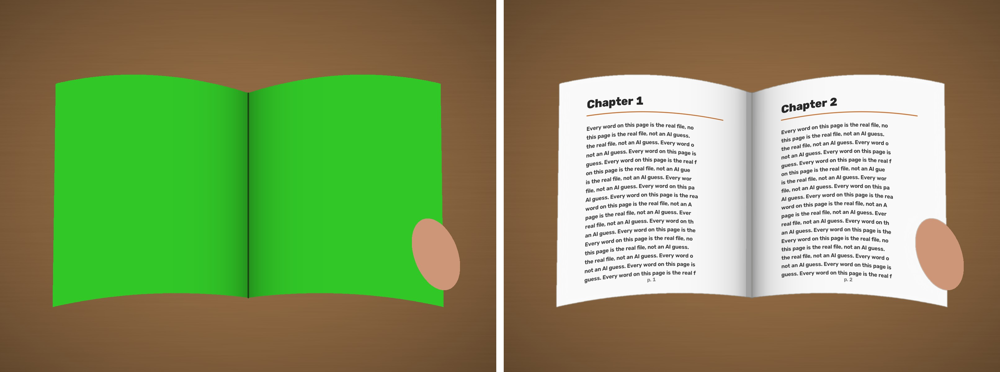
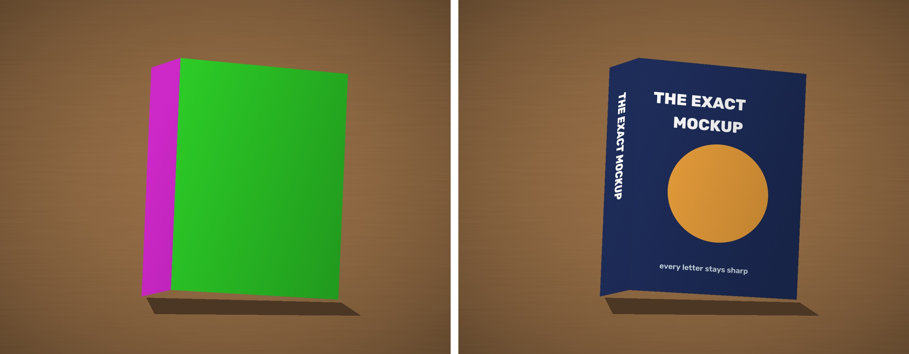

# exact-mockup

**AI image models can't write.** Ask GPT Image, Midjourney or Nano Banana for a photo of your book and the title comes back misspelled, and every page turns into fake text.

`exact-mockup` fixes this. Let the AI handle the photo, then paste your real files in yourself:

1. Generate the scene with **green** where your pages or cover should go (and **magenta** on the spine).
2. Run one command. Your real page or cover goes onto that area following its perspective and paper curve, picking up the photo's own shading, with fingers and clips kept in front.

Every letter is your file, pixel-exact.




## Install

```bash
pip install git+https://github.com/inmersivestate-cmyk/exact-mockup
```

## Pages (open books, sheets, notebooks, printables)

```bash
exact-mockup pages photo.jpg page-left.png page-right.png -o result.jpg
```

- Finds every green area and assigns the page images **left to right**.
- Curved paper is fine: each sheet becomes a smooth patch fitted to its outline (robust to fingers biting the edge).
- If an open book shows up as a single green blob, it is split along the gutter.
- If the sheet's shape doesn't match the page, a paper margin is added so text is never squashed (`--fit stretch` fills the sheet instead).
- `--gutter auto|left|right|none` sets the soft shadow toward the spine. `--upscale 2` makes small text sharper.

## Covers (books, boxes, packaging)

```bash
exact-mockup cover photo.jpg cover.png --spine spine.png -o result.jpg
```

- Green face → cover, magenta face → spine, both with true perspective.
- Without `--spine`, the spine is filled with the cover's edge color.
- Light and shadows come from the green and magenta in the photo, and a little grain is added so it doesn't look pasted (`--grain 0` turns that off).

## Prompting tips for the green version

- Ask for "a blank sheet in **solid chroma-key green (#00FF00)**, evenly lit, no texture". For a cover, say "solid green front cover, solid magenta spine".
- Fingers and objects over the sheet are fine. They are kept.
- Avoid other green in the scene (plants, green clothing), or crop it out.
- Matte works better than glossy, because strong reflections hide the green.

## Try it without any AI

```bash
python examples/make_demo.py
```

This draws synthetic scenes and runs both commands into `examples/demo/`.

## Python API

```python
import cv2
from exact_mockup import paste_pages, paste_cover

out = paste_pages(cv2.imread("photo.jpg"), [cv2.imread("p1.png"), cv2.imread("p2.png")])
out = paste_cover(cv2.imread("box.jpg"), cv2.imread("cover.png"))
```

## License

MIT
